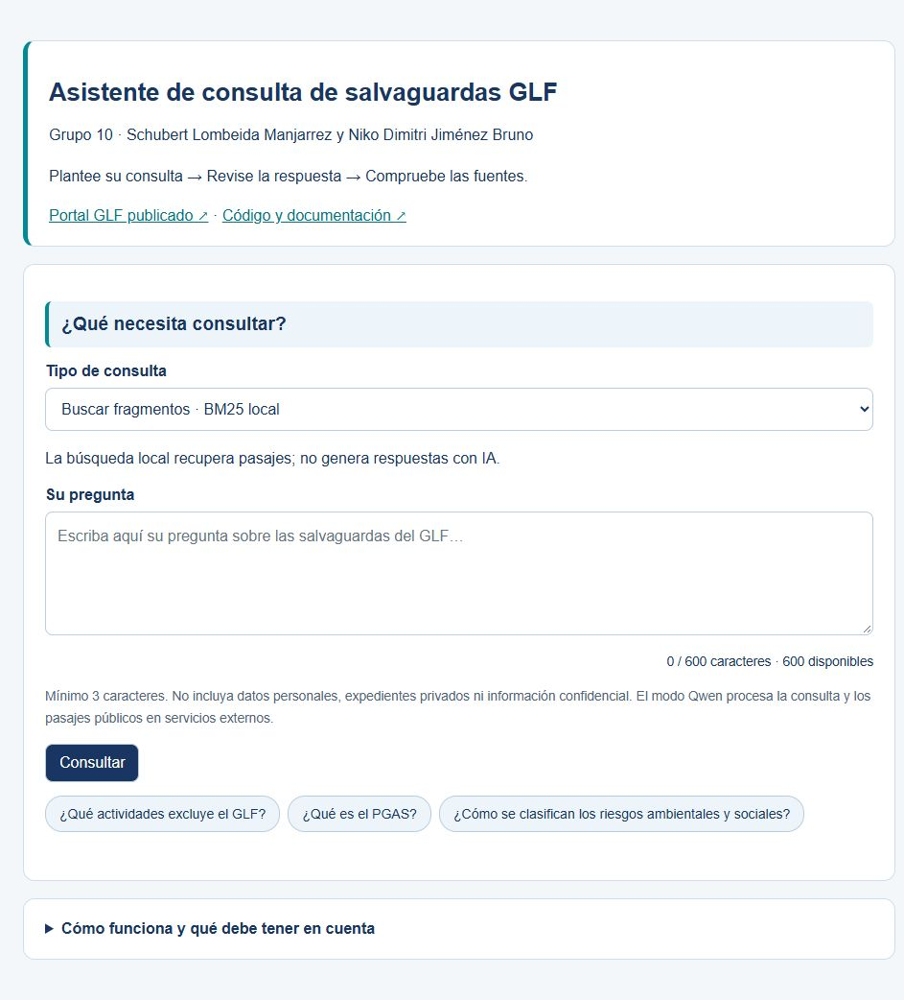

# Asistente RAG de salvaguardas GLF


Grupo 10 · Schubert Lombeida Manjarrez y Niko Dimitri Jiménez Bruno.

[Abrir índice de lectura](https://schubertlombeida.github.io/RAG.SALVAGUARDAS.GLF.UEES/) · [Acceder al asistente GLF](https://glf-postulaciones.vercel.app/internal/evidence)

El índice permite leer los informes en pantalla, abrirlos en GitHub y descargar versiones Word y PDF. Para consultar la implementación, utilice las credenciales facilitadas por el equipo a través del portal de la universidad.

## Contenido

1. [Problema](#problema)
2. [Solución](#solución)
3. [Datos](#datos)
4. [Método](#método)
5. [Resultados](#resultados)
6. [Instalación](#instalación)
7. [Interfaz](#interfaz)
8. [Estructura](#estructura)
9. [Documentación](#documentación)
10. [Ética y límites](#ética-y-límites)
11. [Equipo](#equipo)
12. [Licencias](#licencias)
13. [Fuentes y reconocimientos](#fuentes-y-reconocimientos)
14. [Videos de entrega](#videos-de-entrega)

## Problema

Los especialistas del GLF necesitan localizar requisitos repartidos entre manuales y anexos.
Este sistema recupera evidencia y apoya su consulta. No aprueba proyectos, no determina
financiamiento y no reemplaza la interpretación humana.

## Solución

El [portal GLF publicado](https://glf-postulaciones.vercel.app/) es la interfaz real.
Esta entrega incluye una copia trazable de su integración RAG y una demostración Python
reproducible sobre documentos públicos. Las semanas 1 a 5 entregadas no se modifican.

## Datos

Se distinguen los 26 expedientes históricos privados, el corpus normativo de 585 fragmentos
y siete PDF públicos usados por el servicio generativo. No se publican datos de postulantes.
[Fuentes y derechos](data/README.md) y [manifiesto de descarga](data/sources.json).
El recuento reconstruido se guarda en [public_eda.json](results/metrics/public_eda.json).

## Método

- E5-small genera vectores de 384 dimensiones para recuperación semántica.
- La ruta generativa usa BM25 y Qwen con fuentes y páginas. E5 no alimenta esa generación en la integración revisada.
- El servicio en Hugging Face invoca un proveedor remoto; Vercel no ejecuta los pesos de Qwen.
- Los puntajes de recuperación no son probabilidades de verdad.
- Configuración, límites, contratos y modelos: [arquitectura](docs/arquitectura.md).

## Resultados

Los resultados históricos de BM25 reportan Recall@5 de desarrollo de 68.9 % a 83.6 %.
Corresponden al corpus histórico y su anotación de desarrollo; describen la recuperación en esas consultas y no la exactitud de las respuestas del portal actual.
El benchmark anterior de Qwen 7B local no se transfiere al runtime 72B remoto.
Los originales numéricos y sus límites se conservan en [históricos](results/metrics/historical/PROVENANCE.md).

La actualización documentada el 30 de octubre incorpora la política glf-grounded-v3.1, respuesta ampliada estructurada, validación de integridad y referencias, transporte con reintentos acotados y configuración registrada de Featherless AI para Qwen2.5-72B. Los componentes del portal conservan su instantánea identificada por separado. El protocolo de comparación está en [evaluación](evaluation/README.md), con rejilla reproducible y revisión humana. La fusión BM25/E5 es experimental y no está activada en producción.

Las pruebas de la interfaz del 24 de octubre se registran en [ux_verificacion_20261024.json](results/reports/ux_verificacion_20261024.json). La revisión previa permanece en [verificacion.json](results/reports/verificacion.json).
El alcance empírico comprende evaluación histórica de desarrollo, 33 pruebas académicas y 49 pruebas del servicio más su prueba de integración ejecutadas el 30 de octubre, junto con registros funcionales fechados. Las métricas y los ensayos funcionales se reportan por separado y con sus condiciones de ejecución.

### Comparación histórica de recuperación

| Configuración | Recall@5 de desarrollo |
|---|---|
| BM25 base | 68.9 % |
| BM25 ajustado con k1 = 1.0 y b = 0.2 | 71.5 % |
| BM25 con encabezados y prioridad GLF | 83.6 % |

La diferencia base-final es 14.7 puntos porcentuales. Se conserva el corpus histórico y la anotación de desarrollo de ese experimento; estos valores no miden la calidad de las respuestas actuales de Qwen.

## Instalación

Python 3.12, conexión a Internet para preparar fuentes y entorno virtual.

```bash
python -m venv .venv
# Windows: .venv\Scripts\activate
# Linux/macOS: source .venv/bin/activate
python -m pip install -r requirements.txt
python -m src.data_processing
python -m src.train
python -m pytest -q
python -m app.app
```

Abra http://127.0.0.1:8766. La búsqueda local funciona sin claves y se identifica como
recuperación sin generación. Para respuesta con IA, configure en el servidor GLF_RAG_URL y
GLF_RAG_KEY según .env.example. No se cargan archivos .env automáticamente ni se publican claves.

## Interfaz



Escriba una pregunta o pulse un ejemplo, seleccione modo y consulte. Abra la fuente y
revise la página. Entrada inválida, corpus ausente y servicio no disponible tienen mensajes
propios. El progreso muestra etapas confirmadas por el servidor, modelo efectivo y reloj; permite detener la espera, recuperar las últimas cinco consultas de la sesión y copiar o descargar las referencias. [Manual completo](docs/manual_usuario.md).

## Estructura

```text
index.html      Índice de lectura y acceso al portal GLF
assets/         Diseño, búsqueda y catálogo audiovisual
docs/           Seis informes y guía de revisión
notebooks/      Cinco cuadernos ordenados y ejecutables
src/            Preparación, modelos, índice, evaluación y utilidades
app/            Interfaz Flask con ejemplos y progreso
tests/          Validaciones de datos, recuperación, evaluación y contratos
data/           Manifiesto público y carpetas locales excluidas de Git
models/         Configuración JSON del índice y explicación RAG
integration/    Copias trazables del portal y servicio original
evaluation/     Formatos de anotación, abstención, soporte y tiempos
results/        Figuras, métricas históricas y verificaciones nuevas
entregables/    Informes en Word y PDF
```

El requisito genérico de archivos pickle se adapta a un índice RAG con configuración JSON
y pesos de terceros identificados. No se crean modelos vacíos ni se declara fine tuning.

## Documentación

- [Planificación](docs/planificacion.md)
- [Análisis de datos](docs/analisis_datos.md)
- [Arquitectura](docs/arquitectura.md)
- [Optimización](docs/optimizacion.md)
- [Consideraciones éticas](docs/consideraciones_eticas.md)
- [Manual de usuario](docs/manual_usuario.md)
- [Guía de revisión y presentación](docs/guia_entrega_y_videos.md)

Versiones editables en Word:

1. [Planificación](entregables/01_Planificacion_RAG_GLF.docx)
2. [Análisis de datos](entregables/02_Analisis_de_datos_RAG_GLF.docx)
3. [Arquitectura](entregables/03_Arquitectura_RAG_GLF.docx)
4. [Optimización](entregables/04_Optimizacion_RAG_GLF.docx)
5. [Consideraciones éticas](entregables/05_Consideraciones_eticas_RAG_GLF.docx)
6. [Manual de usuario](entregables/06_Manual_de_usuario_RAG_GLF.docx)
7. [Guía de revisión y presentación](entregables/07_Guia_de_entrega_y_videos_RAG_GLF.docx)

Los Word usan Arial, títulos 12 en negrita, texto 11 negro, tablas grises y gráficos a color. La visualización
Markdown de GitHub usa las fuentes propias de GitHub; el formato solicitado se conserva en Word.

## Ética y límites

Datos privados separados, claves en servidor, decisión humana y fuentes verificables.
Validar citas formales no prueba que todas las afirmaciones estén sustentadas. No se afirma
cumplimiento jurídico integral, impacto social medido ni equidad demográfica de un clasificador
de personas. Las limitaciones y mitigaciones se documentan con su estado real.

## Equipo

Autores: Schubert Lombeida Manjarrez y Niko Dimitri Jiménez Bruno, Grupo 10.
La entrega integra el frente de datos y recuperación con el frente de aplicación, permisos y flujos. La autoría es conjunta.

## Licencias

Código del equipo bajo [MIT](LICENSE). Los documentos GLF y pesos de terceros conservan
sus derechos y licencias. No se redistribuye el corpus privado ni se relicencian los PDF.

## Fuentes y reconocimientos

GLF aporta las fuentes normativas oficiales; el equipo académico es responsable de la
implementación y de sus afirmaciones.
Referencias técnicas: [BM25](https://doi.org/10.1561/1500000019),
[Multilingual E5](https://arxiv.org/abs/2402.05672),
[RAG](https://arxiv.org/abs/2005.11401) y [NIST AI RMF](https://www.nist.gov/itl/ai-risk-management-framework).

## Videos de entrega

La presentación consta de un pitch de 4 minutos y 4 segundos y un video de 12 minutos y 17 segundos con las diez respuestas técnicas. El [índice de revisión](https://schubertlombeida.github.io/RAG.SALVAGUARDAS.GLF.UEES/) y la carpeta [videos](videos/README.md) reúnen los enlaces de reproducción y descarga de los archivos MP4.

<!-- VIDEOS:START -->
- [Presentación del proyecto: ver en línea](https://youtu.be/2KtV_3Zup-0) · [Descargar desde GitHub (MP4 · 720p · 76 MB)](https://github.com/schubertlombeida/RAG.SALVAGUARDAS.GLF.UEES/releases/download/VIDEOS-FINALES/RAG_GLF_PITCH.720.SUBS.mp4)
- [Diez respuestas técnicas: ver en línea](https://youtu.be/U9d4S2_3eO8) · [Descargar desde GitHub (MP4 · 1080p · 186 MB)](https://github.com/schubertlombeida/RAG.SALVAGUARDAS.GLF.UEES/releases/download/VIDEOS-FINALES/RAG_GLF_RESPUESTAS_1080_P08.mp4)
<!-- VIDEOS:END -->

## Índice de revisión

`index.html` permite leer los siete informes sin instalar la aplicación. Incluye búsqueda, enlaces Word/PDF/GitHub y acceso separado al portal GLF. Funciona en una carpeta local o como sitio estático de GitHub Pages. Para regenerarlo desde `docs` y sincronizar los enlaces de grabaciones del catálogo `assets/videos.js`, ejecute `python scripts/build_review_index.py`. Los documentos descargables se conservan en `entregables`.
