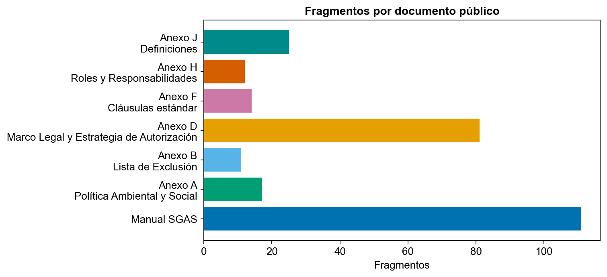
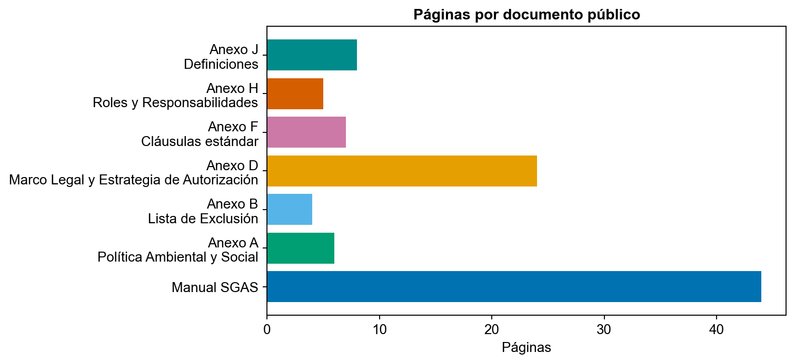
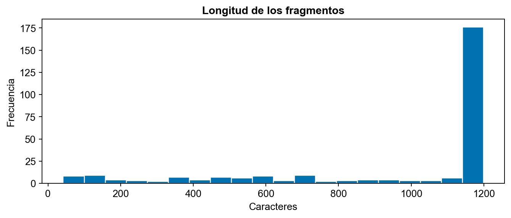
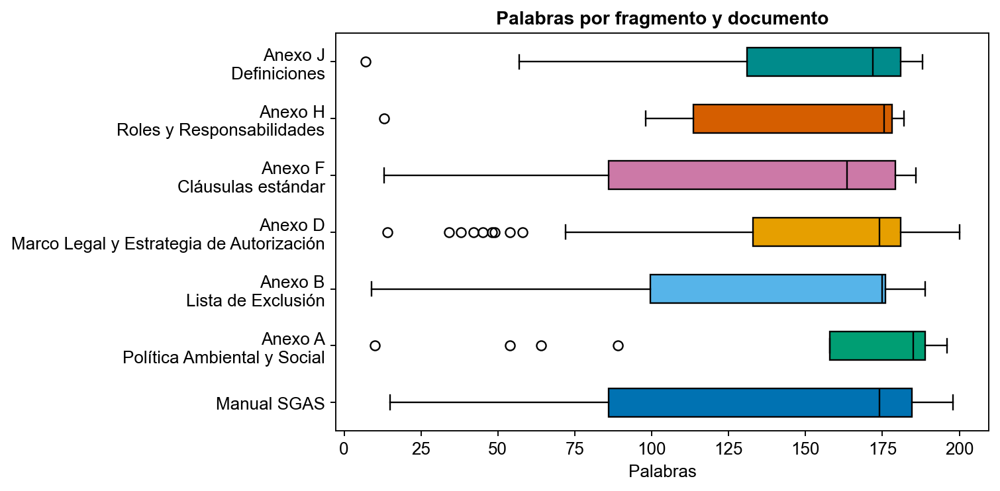
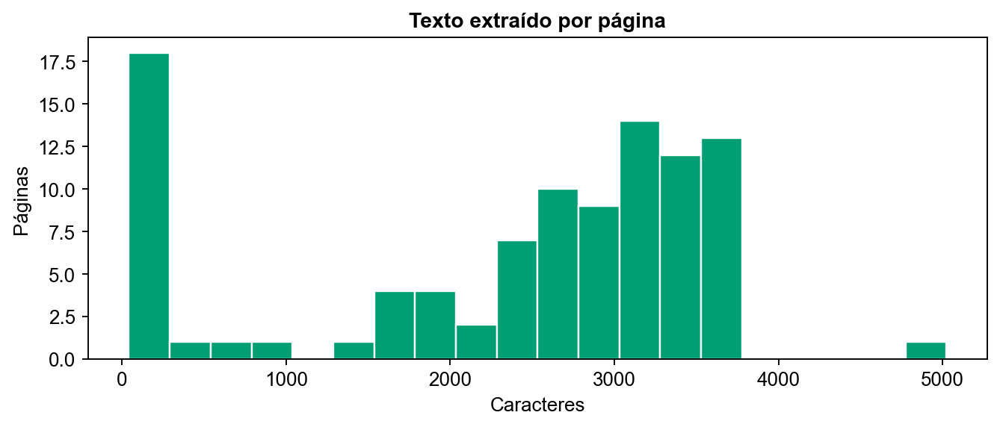
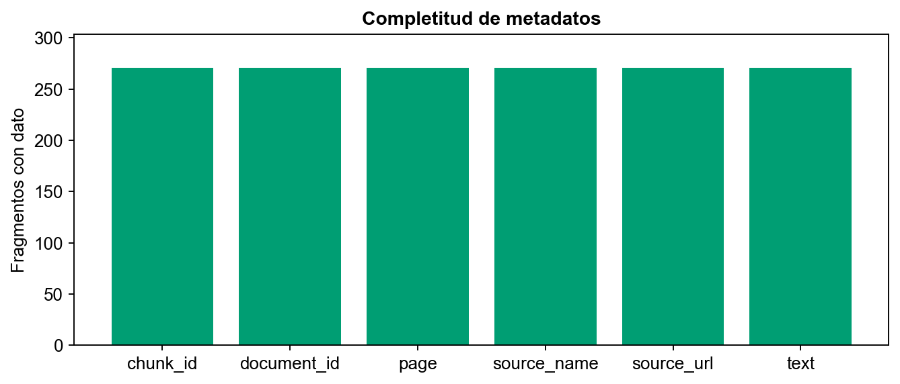

# Análisis de datos del asistente RAG de salvaguardas GLF

Grupo 10 · Schubert Lombeida Manjarrez y Niko Dimitri Jiménez Bruno · Edición 24 de octubre de 2026

## Unidades de análisis y conclusión

La documentación del proyecto contiene varios conjuntos con funciones distintas. Separarlos evita atribuir a un corpus las métricas obtenidas con otro. La muestra de expedientes sirve para estudiar estructura documental; el corpus normativo sirve para recuperar evidencia; las preguntas anotadas permiten evaluar calidad. Ninguno sustituye a los demás.

| Conjunto | Tamaño documentado | Función | Publicación |
|---|---|---|---|
| Expedientes de proyectos | 26 proyectos y 56 documentos | Contexto y exploración documental | No se publica el contenido privado |
| Fragmentos de expedientes | Aproximadamente 250 en el EDA histórico | Análisis de longitudes y particiones | Solo agregados históricos |
| Corpus normativo español | 585 fragmentos de 36 documentos | Ruta E5 y experimentos históricos | No se redistribuye el ZIP |
| Corpus público del servicio Qwen | Siete PDF oficiales | Recuperación lexical y generación | Manifiesto, enlaces y descarga local |

## Procedencia y consistencia

La semana 1 y la ficha técnica reportan 148082 palabras para los expedientes. Un JSON posterior de EDA reporta 147470. Se conservan ambas cifras con su procedencia; no se mezclan como si fueran el mismo cálculo ni se corrigen retrospectivamente los documentos remitidos. Los agregados históricos reportan 26 documentos en español y 30 en inglés, y particiones de 18 proyectos de desarrollo, 4 de validación y 4 de prueba.

La revisión normativa del 12 de octubre encontró 585 fragmentos españoles, frente a 584 citados en un README anterior. También distinguió 62 fragmentos de traducción GLF y 523 de textos normalizados, incluidas guías derivadas. Es incorrecto describir todo ese material como normativa oficial original. La versión exacta debe determinarse por su huella y su manifiesto.

## Preparación del corpus público

El manifiesto data/sources.json identifica Manual SGAS y anexos A, B, D, F, H y J en el dominio oficial del GLF. El script descarga únicamente esas URL HTTPS, comprueba cabecera PDF y límite de tamaño, calcula SHA256 y extrae texto por página. Guarda originales y pasajes solo en carpetas locales excluidas de Git.

Cada pasaje conserva document_id, chunk_id, source_name, source_url, page, language y text. El tamaño objetivo es 1200 caracteres con 180 de solapamiento y corte preferente en un espacio. La página es una coordenada documental real; no se inventa una página a partir de un número de fragmento. El recuento reconstruido y las versiones descargadas se registran en results/metrics/public_sources_manifest.json y public_eda.json.

El corpus histórico E5 utilizó otra preparación: 585 fragmentos dieron lugar a 3549 ventanas de aproximadamente 800 caracteres con avance de 700. Esas ventanas mantienen su fragmento de origen. Un resultado de esa ruta no es directamente comparable con el de siete PDF sin reconstruir antes un corpus común.

## Recuento de la reconstrucción ejecutada

La ejecución produjo siete documentos, 98 páginas y 271 fragmentos. No encontró páginas sin texto extraíble ni duplicados exactos. La mediana fue 1192 caracteres y 174 palabras por fragmento; los seis campos de trazabilidad examinados estuvieron presentes en los 271 registros. Estos controles no sustituyen la revisión del contenido extraído ni la anotación de relevancia.

## Exploración reproducible

El cuaderno 01_exploracion produce las figuras y el resumen numérico del corpus público. No necesita expedientes privados ni etiquetas de relevancia. Las seis figuras responden a preguntas distintas y se calculan desde los pasajes descargados.

La distribución de fragmentos muestra qué documentos dominan el índice. Una fuente extensa puede ocupar muchos puestos del top k; el número de fragmentos no implica mayor autoridad normativa.

El número de páginas permite relacionar cobertura y extensión. La extracción no usa OCR: las páginas sin texto extraíble deben revisarse antes de interpretar una ausencia como inexistencia de la norma.

El histograma permite detectar fragmentos breves y la concentración cerca del límite. Las repeticiones por solapamiento son intencionales y no deben tratarse como observaciones independientes para inferencia estadística.

La variación de palabras por documento ayuda a detectar tablas, listas o extracción irregular. No se presume que un fragmento largo sea mejor evidencia.

El gráfico de caracteres por página identifica valores extremos para inspección. No se elimina una página solo por ser extensa o corta: podría contener una portada, un cuadro o una disposición esencial.

La completitud comprueba la trazabilidad mínima. Es una validación estructural, no una medición de relevancia o de comprensión correcta del PDF.

## Calidad y decisiones

Se rechazan identificadores duplicados, páginas no positivas, fuentes fuera del dominio permitido y pasajes vacíos. Las páginas sin texto y los duplicados exactos se contabilizan en el EDA. No se sustituyen por textos sintéticos. Los valores extremos se conservan para inspección y el solapamiento se documenta.

La fragmentación pequeña facilita citas legibles, pero puede separar una excepción de su regla. Por ello la interfaz abre el PDF en su página y exige revisión humana. Las versiones normalizadas o traducidas necesitan una indicación de autoridad antes de usarse para fundamentar una exigencia.

## Muestreo de evaluación y prevención de fugas

El protocolo propone entre 40 y 60 preguntas sobre un corpus congelado, equilibradas por tema, con 10 a 15 no contestables. Los pasajes correctos deben anotarlos especialistas ajenos a la generación de las preguntas. Las preguntas frecuentes pueden utilizarse como insumo de muestreo. Una respuesta sin páginas y sin revisión especializada no constituye por sí sola un conjunto de referencia independiente.

Se separan desarrollo, validación y test por intención de pregunta. Reformulaciones cercanas pertenecen a la misma partición. Las decisiones de parámetros se toman antes del test. BM25 y E5 reciben los mismos pasajes, identificadores y preguntas. Si cambian los PDF, se genera una nueva huella y se revisan las anotaciones afectadas.

## Derechos y limitaciones

Los PDF públicos mantienen los derechos de sus titulares. El repositorio enlaza las fuentes y permite descargarlas localmente; no aplica MIT a documentos ajenos. Los expedientes, nombres de proponentes y credenciales quedan excluidos. La publicación se limita a fuentes enlazadas, código y agregados documentados. La evaluación incluida caracteriza la preparación del corpus y los experimentos de desarrollo; no aporta una estimación de calidad sobre preguntas anotadas de forma independiente.
