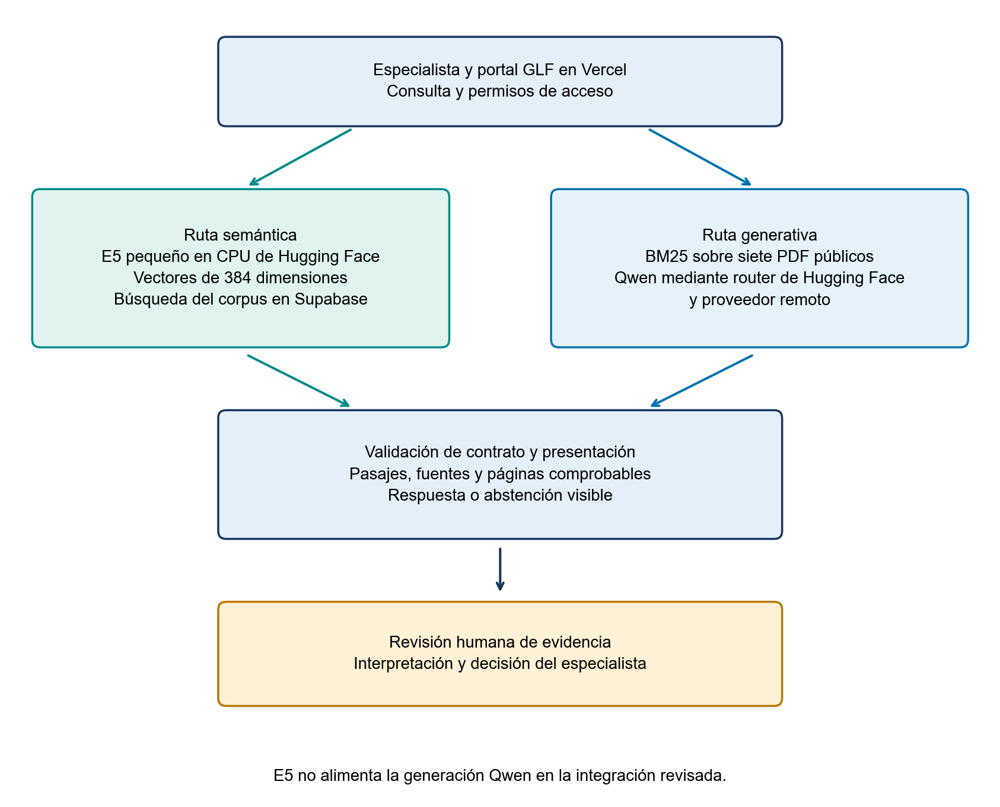

# Arquitectura e integración del asistente RAG GLF

Grupo 10 · Schubert Lombeida Manjarrez y Niko Dimitri Jiménez Bruno · Edición 30 de octubre de 2026

## Sistema entregado y límites

La solución combina un portal web, almacenamiento y recuperación en Supabase y dos rutas de inferencia documental. El portal es la interfaz funcional del proyecto y está publicado en https://glf-postulaciones.vercel.app/. Este repositorio académico copia los componentes RAG necesarios para explicar la integración y conserva su procedencia. No es una réplica de todos los módulos administrativos del sistema de subvenciones.

La referencia del portal revisada es el commit a5a7e5a3ec8703990c2f62ce559536ac0a1eba94, versión 0.7.62. El manifiesto integration/source_manifest.json relaciona cada copia con su ruta y SHA256. La copia no incluye secretos, bases de datos, expedientes ni archivos de entorno reales. Los archivos de integración se conservan como instantánea de evidencia; la ejecución autónoma documentada corresponde a app/app.py.

## Flujo real de la consulta

1. El usuario autenticado entra al asistente del portal y escribe su pregunta o prepara una consulta desde la revisión de un riesgo.
2. El servidor valida texto, permisos y configuración. Las claves no se entregan al navegador.
3. La ruta semántica solicita el vector de la consulta a E5 y busca fragmentos del corpus habilitado en Supabase.
4. La ruta de respuesta envía la consulta al servicio RAG en Hugging Face. Este servicio reconstruye su corpus público, recupera con BM25 y entrega los pasajes al generador Qwen.
5. El servicio comprueba las citas y devuelve una respuesta o abstención. El portal valida de nuevo el contrato de fuentes y páginas.
6. El especialista consulta el documento y decide si la evidencia es pertinente. Un resultado del asistente no modifica por sí solo una aprobación, una categoría de riesgo ni una propuesta.

El contexto de revisión puede separar retrieval_query, orientada al riesgo concreto, de la pregunta de generación. El adaptador conserva hasta tres pasajes específicos y una referencia procedimental cuando la consulta lo necesita. Esa selección no constituye un juicio automático sobre el proyecto.

## Servicios de Hugging Face y evidencia actual

El Space E5 es https://huggingface.co/spaces/Schubertlm/glf-e5-inference y su API de vectores es https://schubertlm-glf-e5-inference.hf.space/embed. La interfaz de Hugging Face mostró estado Running y modalidad protected en la revisión del 23 de octubre. Esa modalidad mantiene privado el repositorio del Space y permite acceder a su URL de aplicación; la API exige además su propia clave. No se publican esas claves.

El servidor E5, copiado en integration/e5-inference, carga SentenceTransformer en CPU. Recibe de uno a ocho textos por solicitud, añade query: o passage: y genera vectores normalizados. Limita la consulta a 1500 caracteres y el pasaje a 12000. El modelo admite una longitud máxima de tokens que puede truncar textos largos; el límite de caracteres no demuestra que no haya truncamiento. La configuración identifica el modelo por nombre, sin fijar una revisión inmutable de sus pesos. Por ello la reproducción debe registrar también la revisión resuelta y la tokenización efectiva.

El Space generativo es https://huggingface.co/spaces/Schubertlm/glf-rag-bm25-qwen. Su ruta /api/ask-stream entrega etapas de procesamiento y resultado; /api/ask conserva compatibilidad con clientes anteriores. La interfaz copiada conserva la referencia 0.7.62; el servicio se actualiza de forma independiente a la política glf-grounded-v3.1. El registro del portal del 30 de octubre muestra versión 0.7.63. La procedencia de ambas capas se identifica por separado en el manifiesto.

La comprobación funcional del 24 de octubre registró consultas Qwen breves y ampliadas, recuperación E5 y manejo de indisponibilidad del proveedor. Una consulta ampliada respondió en 35.2 segundos y otra consulta E5 recuperó seis pasajes en 1.2 segundos. Son observaciones individuales, no un benchmark. Los registros completos y sus diferencias de configuración están en results/live_v0762 y results/reports/quality_verificacion_20261024.json.

Las instantáneas de integración conservan el código de origen y su procedencia. El manifiesto identifica las versiones utilizadas por este informe. Los registros históricos de conectividad se mantienen como evidencia de sus ejecuciones y no sustituyen la descripción de la configuración actual.

## Modelos y funciones

| Componente | Implementación revisada | Entrada y salida |
|---|---|---|
| Representación semántica | intfloat/multilingual-e5-small | Texto query o passage hacia vector de 384 dimensiones |
| Recuperación lexical | BM25-heading-authority-v2 | Consulta hacia hasta cinco pasajes con fuente y página |
| Generación configurada | Qwen/Qwen2.5-72B-Instruct:featherless-ai | Contexto y pregunta hacia texto con identificadores de cita |
| Validación de evidencia | Contrato Python y Zod del portal | Respuesta remota hacia resultado aceptado o error/abstención |
| Datos y permisos | Supabase | Corpus y expedientes separados con controles de acceso |

E5 transforma textos en vectores; no redacta respuestas. La tarjeta del modelo describe prefijos query y passage, normalización y límite de tokens. El código servidor verifica identidad del modelo, 384 valores finitos y norma no nula, y normaliza el vector. La comparación semántica utiliza similitud vectorial; esa puntuación no es una probabilidad de que una norma aplique.

En la configuración documentada de despliegue, Qwen se invoca a través del router de inferencia de Hugging Face y un proveedor remoto. Hugging Face aloja la aplicación Flask; no debe afirmarse que el modelo de 72 mil millones de parámetros se ejecuta en la CPU del Space. HF_TOKEN permite la inferencia y DEMO_ACCESS_CODE protege la API. El identificador 72B corresponde al runtime de integración, mientras que el archivo upstream conserva por defecto un modelo 7B; la documentación y los benchmarks deben declarar cuál se ejecutó realmente.

## Detalle de recuperación y generación

El recuperador histórico normaliza acentos, tokeniza y calcula BM25 para cuerpo y encabezados. La configuración congelada combina cuerpo con k1 igual a 0.8 y b igual a 0.2, encabezados con k1 igual a 1.2 y b igual a 0.3, peso 0.30 de encabezados y 0.15 de prioridad GLF. Es una prioridad editorial limitada, no una medida de certeza. Una priorización puede recuperar fuentes aun con coincidencia escasa; la abstención debe medirse de extremo a extremo.

El código upstream se conserva como procedencia. El adaptador documentado aplica glf-grounded-v3.1: selecciona hasta cinco pasajes sin volver a recortar su texto, elimina duplicados y conserva identificador, página y fuente. No altera la fragmentación original. La pregunta y los documentos se delimitan como datos; el prompt distingue requisitos, definiciones, condiciones, fases y aspectos sin evidencia. Cada afirmación documental debe citar un identificador del contexto. La comprobación formal de citas no prueba su soporte semántico.

E5 y Qwen son rutas independientes en la integración revisada. El documento de arquitectura propuesto en una semana anterior incluía fusión y reranker, pero no se presenta esa propuesta como una característica ya desplegada. Los resultados del corpus normativo de 585 fragmentos tampoco se transfieren al corpus público de siete PDF.

## Respuesta breve y análisis ampliado

El modo breve usa un límite de 700 tokens de salida y una orientación de 200 palabras. El ampliado usa 1000 tokens y una orientación de 300 palabras. Son límites de generación, no compromisos de longitud ni medidas de exactitud. El contexto admite hasta 12000 o 18000 caracteres, respectivamente; no son tokens exactos y puede contener menos de cinco pasajes.

Los reintentos de transporte y corrección de citas comparten un máximo total de dos solicitudes al proveedor y un presupuesto de 50 segundos. Si el proveedor informa fin por longitud o salida incompleta, la respuesta parcial no se publica como resultado válido. Se conservan los pasajes para revisión. Cuando no hay evidencia suficiente se mantiene la abstención.

El detalle de ejecución registra modo, política, modelo efectivo, IDs del contexto, huella SHA-256 del corpus público, intentos, tiempos y tokens que realmente reporta el proveedor. Un consumo ausente se identifica como no reportado; uno parcial no se transforma en costo cero. Los registros del servidor contienen metadatos operativos, sin guardar la pregunta ni el texto de los documentos.

El Space continúa como coordinador en CPU Basic. El registro de despliegue del 30 de octubre identifica Featherless AI mediante Hugging Face, tras incidencias de espera con DeepInfra; los pesos de Qwen se ejecutan en ese proveedor remoto. No se modifica el nivel de hardware del Space. Una respuesta más larga puede consumir más inferencia. La consulta extendida es optativa y el modo breve es el inicial.

## Validación de la respuesta ampliada

La política glf-grounded-v3.1 solicita un objeto JSON con decisión de abstención, hasta cuatro párrafos y referencias F1 a F5 limitadas a los pasajes presentes. Cada párrafo admite de 20 a 700 caracteres. El servidor comprueba la estructura completa, la presencia de texto, la terminación de las frases y las referencias seleccionadas antes de componer la prosa. Une una frase que continúa en el párrafo siguiente conservando sus palabras y referencias; rechaza una frase final incompleta. Una cita formalmente válida no acredita por sí sola respaldo semántico.

El transporte SSE, eventos enviados por el servidor, se acumula internamente hasta disponer del resultado completo. La pantalla recibe las etapas de procesamiento, pero no una respuesta parcial presentada como terminada. La normalización de espacios de puntuación se limita al prompt; la consulta original se conserva.

## Contratos y controles técnicos

El servidor E5 recibe JSON con inputs y kind. Debe responder model y embeddings. La solicitud usa HTTPS, rechaza redirecciones y permite un reintento ante fallos transitorios de transporte o estados 502, 503 y 504, con espera máxima de 25 segundos por intento. No se cambia de modelo silenciosamente ante un error.

La consulta Qwen acepta entre 3 y 600 caracteres. El contrato exige generated, answer, sources, results y tiempos. Cada fuente debe ser HTTPS del dominio oficial, tener página positiva y corresponder al pasaje devuelto. Las referencias no pueden duplicarse. Una abstención mantiene sources vacío; los resultados pueden mostrarse como material para revisión, sin atribuirles una afirmación generada.

El portal limita a 60 segundos la comunicación remota y el navegador a 80 segundos de espera. La ruta de Vercel admite hasta 90 segundos. Detener espera cancela la recepción del navegador, pero no garantiza detener un trabajo ya recibido por el proveedor. El adaptador limita su presupuesto de generación y reintento a 50 segundos. El servicio aplica límites temporales por dirección IP y una cuota global diaria en memoria. Estos controles reducen abuso, pero se reinician con el proceso y no equivalen a un límite persistente de gasto. El presupuesto del proveedor debe administrarse por separado.

## Progreso y recuperación ante errores

El servidor del portal transmite eventos NDJSON, es decir, objetos JSON separados por saltos de línea. E5 informa transformación de la consulta y búsqueda en Supabase. El servicio generativo informa recuperación BM25, preparación de evidencia, generación Qwen y comprobación de referencias desde el código que realiza cada operación. El nombre completo del modelo procede de la configuración efectiva; el reloj del navegador mide espera y no simula un porcentaje de avance.

Los contratos validan tamaño, eventos, resultados e identificadores de fuente. Los mensajes distinguen entrada inválida, desconexión, espera agotada, cuota, configuración, indisponibilidad, permisos y respuesta inválida. Los errores conservan la pregunta y ofrecen reintento únicamente cuando corresponde. El historial mantiene cinco resultados en memoria de la pantalla y se vacía al salir o cambiar de contexto. Las notas asociadas a riesgos conservan sus permisos y su almacenamiento habitual.

## Reproducción y versiones

La interfaz académica Flask funciona en 127.0.0.1:8766. Sin credenciales ejecuta una búsqueda BM25 local y la identifica como recuperación, sin simular generación. Si se configuran GLF_RAG_URL y GLF_RAG_KEY en el servidor, puede usar el servicio autenticado del portal. El modo remoto nunca incorpora la clave al HTML.

requirements.txt fija las dependencias académicas; environment_lock.txt captura las versiones efectivamente instaladas. El código del portal conserva su package.json y lockfile en integration/portal/web. El servicio original conserva runtime.py, Dockerfile, requirements y UPSTREAM.json. Construir el índice en src/train.py no entrena un LLM: genera una configuración JSON con la huella de los datos.

## Interpretabilidad y límites operativos

La evidencia observable es el pasaje, la fuente, la página, el identificador y el tiempo. No se muestra un porcentaje de confianza fabricado a partir del puntaje de BM25 o del coseno de E5. La verificación de formato previene citas inexistentes, pero no detecta todas las contradicciones, omisiones o interpretaciones erróneas. Por eso la interpretación documental permanece bajo revisión humana.

Fuentes técnicas: Robertson y Zaragoza, BM25 and Beyond, https://doi.org/10.1561/1500000019; Wang y colaboradores, Multilingual E5 Text Embeddings, https://arxiv.org/abs/2402.05672; tarjeta E5, https://huggingface.co/intfloat/multilingual-e5-small; Lewis y colaboradores, Retrieval Augmented Generation, https://arxiv.org/abs/2005.11401.
