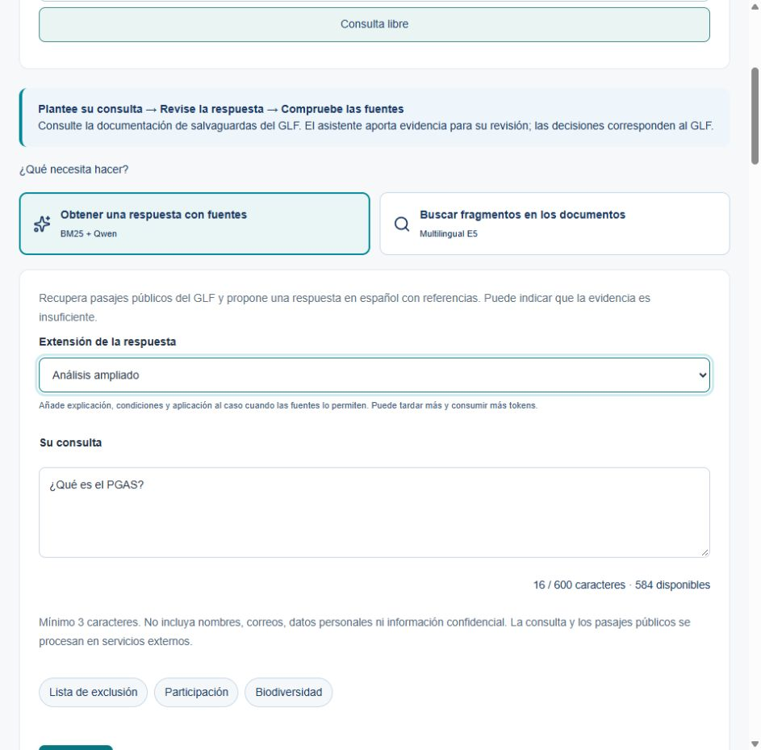
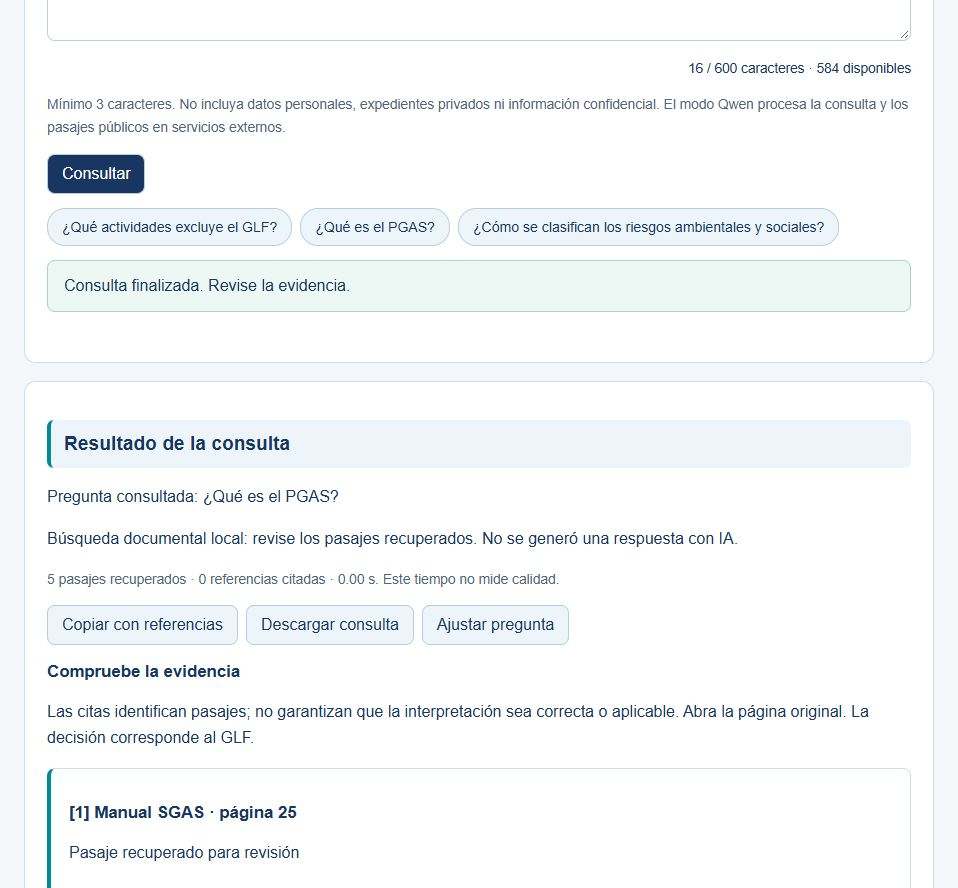

# Manual del asistente documental de salvaguardas GLF

Grupo 10 · Schubert Lombeida Manjarrez y Niko Dimitri Jiménez Bruno · Edición 30 de octubre de 2026

## Para qué sirve

Este manual explica cómo consultar evidencia normativa mediante el portal GLF y cómo reproducir la interfaz académica del Grupo 10. El asistente ayuda a localizar disposiciones y muestra sus fuentes. El usuario debe leer los pasajes y comprobar su pertinencia; el sistema no concede financiamiento, no determina elegibilidad y no reemplaza al especialista.

## Acceso al portal publicado

1. Desde index.html elija Portal GLF y Abrir el asistente. También puede acceder a https://glf-postulaciones.vercel.app/internal/evidence con la cuenta de evaluación facilitada por el equipo.
2. Inicie sesión y entre al módulo del asistente RAG o al espacio de revisión permitido por su rol.
3. Elija Consulta libre o Desde un proyecto. En este último caso seleccione el expediente y riesgo correspondiente; las notas siguen vinculadas al riesgo seleccionado.
4. Seleccione Obtener una respuesta con fuentes para BM25 y Qwen, o Buscar fragmentos en los documentos para E5. Qwen admite de 3 a 600 caracteres; E5, de 10 a 1500. Escriba una pregunta concreta.
5. En Qwen, elija Respuesta breve para una consulta puntual o Análisis ampliado para distinguir disposición, aplicación sustentada y aspectos por verificar. El modo ampliado puede tardar más y consumir más inferencia. Pulse Consultar y observe la etapa, el modelo y el reloj. El sistema evita envíos duplicados mientras procesa.
6. Revise la respuesta, las referencias numeradas y la página original. Mantenga separada la evidencia encontrada de la decisión técnica.

La cuenta y contraseña para la profesora se comparten por el portal de la universidad, fuera del repositorio público. Este manual no publica credenciales ni instruye usar una cuenta administrativa personal. La disponibilidad del módulo depende de los permisos asignados a esa cuenta.



## Durante el procesamiento

El reloj informa el tiempo transcurrido. El nombre del método o modelo y las etapas se reciben del servidor: búsqueda de documentos, preparación de evidencia, generación de Qwen y comprobación de referencias, según la ruta elegida. En E5 se informa también la transformación de la consulta en un vector. El reloj no representa un porcentaje de avance ni una medida de calidad.

Detener espera libera la pantalla y conserva la pregunta. Una solicitud ya recibida podría continuar y contabilizarse en el servicio externo. Espere antes de repetir una consulta larga. Si se agota el tiempo, la pantalla explica lo sucedido y ofrece reintentar cuando corresponda.

## Interpretar la evidencia



Cada resultado incluye documento, página e identificador de pasaje. Abra la fuente original para comprobar contexto, excepciones y vigencia. El puntaje de recuperación, cuando se consulte por API, ordena pasajes y no indica certeza. El tiempo mostrado corresponde a esa consulta, no a una evaluación estadística del sistema.

Si el servicio se abstiene, significa que no pudo producir una respuesta con evidencia suficiente bajo sus controles. No interprete esa abstención como inexistencia del requisito. Consulte el documento original o al especialista. Si aparecen pasajes en una abstención, son material de apoyo y no citas de una afirmación generada.

## Conservar y revisar una consulta

Copiar con referencias y Descargar consulta conservan la pregunta, respuesta, pasajes, fuentes, páginas, modelo e identificador de ejecución. La descarga es un archivo de texto. Ajustar pregunta vuelve al campo para reformularla; el resultado anterior no se atribuye a la nueva pregunta.

Consultas de esta sesión permite recuperar las últimas cinco respuestas sin volver a invocar el servicio. Se conserva únicamente en la página actual y se elimina al recargar, salir o cambiar de contexto. Vaciar historial lo borra de la pantalla. Este historial es independiente de las notas de revisión que un usuario autorizado guarda por riesgo.

Detalles de esta ejecución muestra el modelo, modo elegido, tiempo, versión e identificador disponibles. Cuando el servicio los reporta, incluye política, huella del corpus, intentos, tokens de entrada y salida y límite de generación. Los tokens no son un precio ni un porcentaje de precisión; el aviso parcial indica que falta información de alguna llamada. Se usa para comprender la ejecución y reportar un problema; no son métricas de precisión.

## Consultas recomendadas

Puede preguntar qué actividades figuran en la lista de exclusión, qué es un PGAS o cómo se describen las categorías ambientales y sociales. Es preferible una pregunta concreta a copiar un expediente completo. Para un riesgo específico, describa la actividad y el aspecto que quiere contrastar sin incluir nombres personales, cédulas ni datos reservados.

Una pregunta sobre la aprobación de un proyecto particular o información que no está en las fuentes debe remitirse a la revisión humana. La recuperación de una definición no basta para concluir que una actividad está permitida o excluida.

## Errores frecuentes

| Mensaje o síntoma | Qué hacer |
|---|---|
| Texto demasiado corto o largo | Consulte el contador: Qwen y demostración local admiten 3 a 600 caracteres; E5 del portal, 10 a 1500 |
| Sin conexión o tiempo agotado | La pregunta se conserva; vuelva a consultar cuando haya conexión o transcurra un momento |
| Sesión vencida o acceso restringido | Inicie sesión de nuevo o solicite al administrador el acceso correspondiente |
| Corpus no preparado | Ejecute python -m src.data_processing y vuelva a abrir la aplicación |
| Servicio RAG sin configurar | Utilice búsqueda local o solicite configuración al equipo |
| Respuesta inválida o citas no verificadas | El resultado no se presenta como evidencia validada; ajuste la pregunta o consulte las fuentes |
| La generación quedó incompleta | La salida parcial se retira. Revise los pasajes y formule una pregunta más concreta o cambie la extensión antes de intentar de nuevo |
| Cuota o límite temporal | Espere el plazo indicado y evite repetir solicitudes |
| Cita que no respalda la afirmación | Registre pregunta, pasaje y discrepancia para revisión técnica |
| Fuente cambia o no abre | Revise el enlace oficial y regenere el corpus con una versión nueva |


## Preguntas frecuentes de uso

### Cuándo elegir respuesta con fuentes o búsqueda de fragmentos

Use respuesta con fuentes si necesita una explicación redactada a partir de los documentos recuperados. Use búsqueda de fragmentos si prefiere leer directamente pasajes seleccionados por su significado. Son rutas diferentes; un resultado de búsqueda no es una respuesta redactada ni una decisión técnica.

### Qué cambia entre respuesta breve y análisis ampliado

La respuesta breve prioriza una consulta puntual. El análisis ampliado puede desarrollar hasta cuatro párrafos con referencias y aspectos no resueltos. Su extensión está acotada y puede variar según la evidencia; no garantiza más precisión. Los controles de integridad se aplican antes de mostrar el texto.

### Por qué aparecen documentos que no responden la pregunta

La búsqueda puede recuperar pasajes poco pertinentes, especialmente ante preguntas ajenas a salvaguardas. Compruebe su contenido antes de utilizarlos. Reformule la consulta dentro del dominio o consulte al especialista; una lista de fuentes no demuestra que exista respuesta.

### Qué significa que la generación quedó incompleta

El servicio no recibió o no validó una respuesta terminada. La pantalla retira el texto parcial y puede conservar los pasajes para revisión. Ajuste la pregunta o pruebe una respuesta breve; repetirla no garantiza que el proveedor esté disponible.

### Si una respuesta tiene citas ya puedo utilizarla como conclusión

No. Abra el documento, compruebe la página y lea las condiciones y excepciones. El sistema valida la existencia de referencias, pero la interpretación y la decisión siguen a cargo de la persona revisora.

### Qué información puedo escribir

Use preguntas sobre normativa pública. No incluya nombres, cédulas, contraseñas ni expedientes reservados. La consulta y los pasajes públicos de contexto pueden procesarse en servicios externos.

## Soporte y límites

La recuperación local no genera respuestas; Qwen requiere la conexión remota configurada. La calidad normativa se contrasta con fuentes y revisión especializada; las pruebas funcionales no equivalen a una estimación de exactitud. No publique expedientes ni claves en el repositorio.

Copiar datos del problema conserva método, código e identificador, sin la pregunta ni credenciales. Para solicitar soporte, adjunte esos datos en Issues del repositorio académico. La aplicación no envía reportes automáticamente. Las consultas normativas corresponden al especialista del GLF.

## Instalación de la aplicación académica

Abra una terminal en la raíz del repositorio. Utilice Python 3.12 y cree un entorno virtual antes de instalar dependencias.

```text
python -m venv .venv
.venv\Scripts\activate
python -m pip install -r requirements.txt
python -m src.data_processing
python -m src.train
python -m app.app
```

En Linux o macOS active el entorno con source .venv/bin/activate. Abra http://127.0.0.1:8766. La preparación inicial requiere Internet para descargar los PDF oficiales. Si una URL cambia, el proceso falla de forma visible y debe actualizarse el manifiesto y la versión del corpus.

## Hacer una consulta en la demostración


La pantalla presenta la caja de pregunta, el modo de consulta, el botón Consultar y ejemplos. Escriba entre 3 y 600 caracteres. Un ejemplo rellena la caja para que pueda leerlo o modificarlo antes de consultar. El botón muestra progreso y se bloquea durante la operación.

El modo Búsqueda local de pasajes funciona sin claves y utiliza BM25. Devuelve texto recuperado para revisión y lo identifica explícitamente como búsqueda sin generación. El modo Respuesta con IA del servicio del portal necesita que el equipo configure GLF_RAG_URL y GLF_RAG_KEY en el servidor. No escriba claves en el navegador ni las agregue a un cuaderno.


## Lectura de la documentación académica

El archivo index.html reúne los informes, el código y la evidencia de evaluación. En Documentación puede buscar por tema, elegir un informe y leerlo en pantalla. Cada informe ofrece su fuente en GitHub y sus versiones Word y PDF. El menú Portal GLF abre el acceso al asistente publicado; el índice no solicita ni almacena credenciales.

El contenido audiovisual se organiza en un pitch de 4 minutos y 4 segundos y un video de diez respuestas técnicas. El catálogo audiovisual centraliza los enlaces de reproducción utilizados por el índice y el README.
