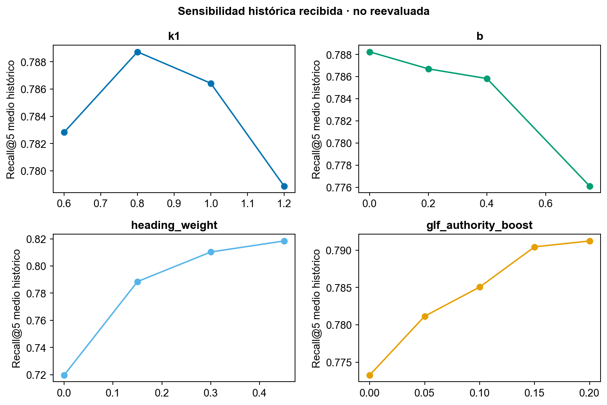
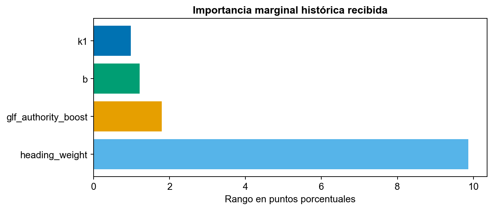
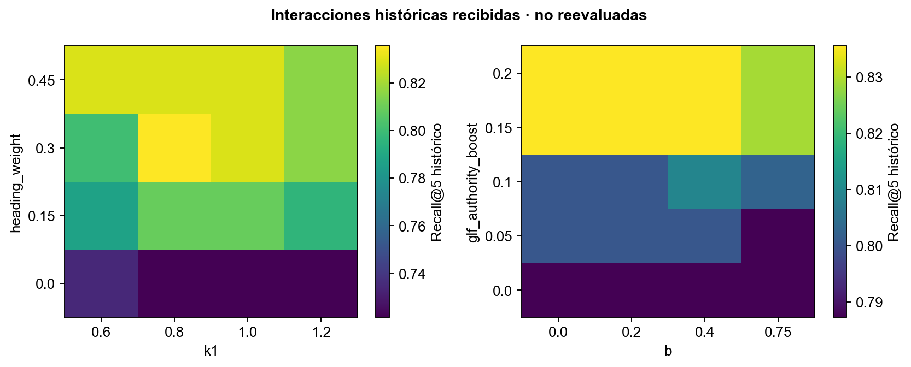

# Optimización y evaluación del asistente RAG GLF

Grupo 10 · Schubert Lombeida Manjarrez y Niko Dimitri Jiménez Bruno · Edición 30 de octubre de 2026

## Qué se optimizó y qué puede concluirse

El proyecto contiene dos líneas de experimentación: un clasificador exploratorio de relevancia de pares consulta y pasaje, presentado en la semana 4, y una optimización posterior del recuperador BM25. Se describen separadamente porque tienen objetivos, datos y métricas distintos. Los archivos históricos se preservan en results/metrics/historical con su procedencia y no se presentan como nuevas mediciones ni como estimaciones de exactitud del portal.

## Experimento supervisado de la semana 4

El reporte utilizó 50 pares propuestos por IA a partir de los cinco primeros resultados BM25 para diez consultas. Tras excluir tres pares inciertos y uno duplicado entre particiones, quedaron 28 pares de entrenamiento, nueve de validación y nueve de prueba. Los datos se separaron por consulta. El conjunto de prueba tenía ocho positivos y un negativo.

La representación TF IDF de unigramas y bigramas se ajustó solo con entrenamiento y produjo 24001 características al concatenar consulta, documento, interacción y coseno. Se compararon descenso de gradiente sin regularización, regularización L2 y parada temprana. Estos experimentos no entrenaron E5 ni Qwen.

| Configuración histórica | Pérdida de validación | Exactitud balanceada de validación | Lectura |
|---|---|---|---|
| Base de 200 épocas | 0.8662 | 50 % | Referencia exploratoria |
| L2 con alfa 0.01 | 0.6801 | 50 % | Menor pérdida sin mejora de discriminación |
| Parada temprana restaurando época 2 | 0.6235 | 50 % | Mejor pérdida de validación, mismo problema de clase |

En prueba, todas las variantes predijeron la clase positiva. La exactitud de 88.9 % se explica por el desbalance de ocho positivos entre nueve casos; la exactitud balanceada fue 50 % y F1 macro 0.4706. El resultado no justifica desplegar ese clasificador. No se vuelve a elegir una configuración mirando el test.

## Optimización histórica de BM25

Los archivos posteriores registran un corpus de 585 fragmentos y 38 preguntas de desarrollo, divididas en 27 train y 11 validation. La primera etapa varió k1 y b. La segunda añadió encabezados y una prioridad moderada a fuentes GLF. El archivo optimization_summary.json conserva los resultados, y delimita su uso como resultados de desarrollo con anotación no independiente.

| Configuración reportada | Recall@5 de desarrollo | Estado de la evidencia |
|---|---|---|
| BM25 base k1 1.5 y b 0.75 | 68.9 % | Resultado histórico |
| BM25 ajustado k1 1.0 y b 0.2 | 71.5 % | Resultado histórico |
| BM25 con encabezados y prioridad GLF | 83.6 % | Resultado histórico, etiquetas de desarrollo |

La mejora histórica de 14.7 puntos porcentuales compara configuraciones sobre ese conjunto de desarrollo. No demuestra mejora sobre nuevas preguntas, E5-small ni la versión publicada de 72B. Su alcance es el conjunto de desarrollo descrito, sin extrapolación a precisión normativa en producción.

## Sensibilidad y dependencia marginal

La documentación histórica describe una rejilla post congelamiento de 320 combinaciones: k1 en 0.6, 0.8, 1.0 y 1.2; b en 0.0, 0.2, 0.4 y 0.75; peso de encabezados en 0.0, 0.15, 0.30 y 0.45; prioridad GLF en 0.0, 0.05, 0.10, 0.15 y 0.20. Los CSV marginales e interacciones se conservan como evidencia recibida. No se dispone aquí de todas las ejecuciones individuales de la rejilla ni se afirma haberla repetido.

En un recuperador se adapta la dependencia parcial a la media de Recall@5 sobre combinaciones de hiperparámetros. Esta visualización es un análisis de sensibilidad de una métrica, no una explicación causal de atributos de personas ni el PDP de un clasificador supervisado.

El rango entre el mayor y menor promedio marginal fue 9.87 puntos para encabezados, 1.80 para prioridad GLF, 1.21 para b y 0.98 para k1. Depende de los rangos explorados y de la muestra; no es una clasificación universal de importancia.

Las interacciones conservadas relacionan k1 con peso de encabezados y b con prioridad GLF. La región descrita favoreció encabezados cercanos a 0.30. El análisis caracteriza la sensibilidad histórica; describe los rangos explorados en ese experimento.

## Latencia y comparación justa

Un benchmark anterior reportó 40 consultas exitosas con Qwen 7B local, tres calentamientos excluidos, mediana 1.815 segundos y percentil 95 de 4.617 segundos. Son resultados del entorno local documentado en ese experimento. No miden el portal Vercel, el proveedor DeepInfra ni el arranque en frío de los servicios actuales. La entrega separa las comprobaciones funcionales y la latencia de una consulta de un benchmark.

La comparación de recuperadores requiere un mismo corpus, preguntas y top k. El código separa los ajustes y la evaluación de prueba y registra los metadatos de ejecución. Las similitudes y distancias no se presentan como probabilidades de corrección.

## Métricas y herramientas reproducibles

El módulo src/evaluate.py implementa Hit@5, Recall@5, Precision@5 y MRR@5 por pregunta y tema. Diferencia recuperar al menos un pasaje correcto de recuperar todos los relevantes. Para evitar mezclar versiones, verifica la huella del corpus y los metadatos de las etiquetas. Las preguntas no contestables se evalúan aparte y no se convierten en Recall igual a cero.

El cuaderno 05 comprueba el cálculo con ejemplos sintéticos explícitos. Las pruebas verifican los denominadores, las validaciones y el aislamiento de particiones. Las métricas empíricas de esta entrega son las de los experimentos históricos descritos; las pruebas del código y las consultas funcionales se reportan por separado.

La carpeta evaluation documenta los formatos que aceptan las utilidades del repositorio. Sus plantillas definen contratos de datos, no resultados adicionales del proyecto.

## Mejoras de interfaz y pruebas funcionales

La actualización del 24 de octubre incorpora orientación por tarea, ejemplos editables, límites de entrada, avance real por etapas, modelo ejecutado, reloj, cancelación de espera, referencias numeradas, exportación con fuentes e historial temporal. Los fallos de conexión, cuota, configuración, formato y citas tienen mensajes distintos. La interfaz no transforma similitud en confianza ni presenta una abstención como aprobación del proyecto.

El registro del 24 de octubre documenta 33 pruebas de la aplicación académica, 187 pruebas TypeScript y 81 de base de datos y funciones del portal, y 25 pruebas Python del servicio más su smoke test. Se verificaron resultados, error, cancelación, historial y adaptación móvil en navegador, y ambas rutas publicadas con consultas reales. Los archivos results/reports/ux_verificacion_20261024.json y quality_verificacion_20261024.json delimitan la evidencia de cada revisión. Estas pruebas verifican contratos y comportamiento del software; no son métricas de exactitud normativa.

## Comprobación funcional del 30 de octubre

Se ejecutaron nuevamente las 33 pruebas del núcleo académico. La copia actualizada del servicio glf-grounded-v3.1 superó 49 pruebas unitarias y su prueba de integración. Las pruebas usan proveedores sintéticos para verificar límites, reintentos, referencias, contenido estructurado y errores; no realizan inferencia de pago ni estiman exactitud normativa. Los conteos se registran por componente y fecha, sin sumarlos a ejecuciones históricas como si fueran una sola batería nueva.

El registro operativo conservado contiene seis consultas ampliadas aceptadas y tiempos entre 5.09 y 22.56 segundos. Es una muestra funcional seleccionada, no un benchmark ni una medida de exactitud. El caso E5 documentado el 30 de octubre recuperó pasajes que no respondían una pregunta sobre fútbol; demuestra un fallo de pertinencia fuera del dominio, no una alucinación de Qwen ni una tasa de error. El resumen verificable está en results/reports/actualizacion_20261030.json.

## Optimización reproducible de esta entrega

src/optimize.py implementa una rejilla de doce combinaciones: k1 en 0.8, 1.2 y 1.5; b en 0.2 y 0.75; peso de encabezados en 0.0 y 0.3. Exige desarrollo y validación con anotaciones aprobadas, rechaza preguntas o grupos de intención compartidos y no recibe test. Selecciona por Recall@5 de validación, desempata con MRR@5 y después con menor peso de encabezados. Conserva todas las ejecuciones por pregunta y genera gráficas a color de sensibilidad, importancia marginal e interacción. Sus pruebas usan datos sintéticos identificados como tales; no son nuevos resultados GLF.

src/evaluate.py permite evaluar BM25, BM25 ajustado, E5 y fusión RRF sobre los mismos registros y metadatos. RRF significa Reciprocal Rank Fusion, fusión mediante el inverso del rango; evita sumar puntajes de escalas distintas. La fusión está disponible para el experimento académico y no se activa en el portal en la integración documentada.

src/answer_evaluation.py resume revisión humana de afirmaciones y utilidad, abstenciones con denominadores separados e intervalos Wilson del 95 %, y tiempos manuales y asistidos pareados. No usa Qwen como juez de sus propias respuestas. La fracción de afirmaciones sustentadas no recibe un intervalo binomial que ignore la correlación dentro de cada respuesta.

El protocolo ejecutable, campos y comandos están en evaluation/README.md. La referencia anterior del portal se conserva en results/baseline_v0761. Una consulta de ejemplo permite observar el cambio de formato, pero no cuantificar una mejora general.

## Aporte a la rúbrica

La implementación aporta evidencia verificable a funcionamiento, usabilidad, código, documentación, optimización, evaluación y ética: modos de respuesta acotados, contratos y errores probados, trazabilidad del contexto y experimentos reproducibles con separación de particiones. El puntaje académico no se anticipa. El alcance empírico se limita a las mediciones documentadas y a las versiones identificadas.

## Decisión técnica

La solución utiliza búsqueda interpretable y validación de fuentes. El clasificador exploratorio no se despliega porque su exactitud balanceada no evidencia discriminación útil. Los resultados históricos fundamentan el diseño y sus límites; las pruebas actuales verifican contratos e interacción. Las conclusiones se limitan a las consultas, corpus y configuraciones documentados.
